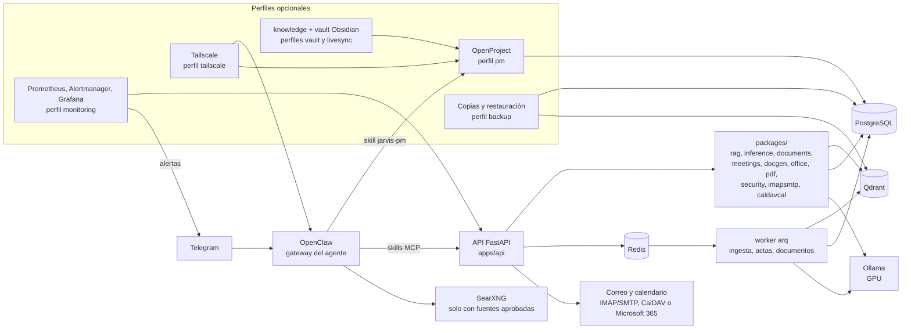

# Jarvis Local

[](LICENSE)


Asistente de IA privado y local para *project managers*, nacido como Trabajo Fin de Máster
(JARVIS-PMI). Responde sobre la documentación propia, separada por empresa y proyecto,
citando documento y página, y se abstiene cuando no encuentra evidencia. Desde Telegram
gestiona tareas, hitos y riesgos en OpenProject, convierte la grabación de una reunión en
un acta, lleva correo y calendario, genera documentos y guarda la memoria en Obsidian.
Cualquier acción con efecto fuera del servidor espera un "sí" del propietario. La
inferencia (Ollama con GPU) y el RAG son 100 % locales: ningún documento, embedding, prompt
o respuesta sale del servidor hacia APIs de modelos en la nube. Solo salen los mensajes de
Telegram y lo que Jarvis envía o lee en tu cuenta de correo. Todo se levanta con
`docker compose up`.

> **English summary.** A private, self-hosted AI assistant for project managers, built as a
> master's thesis. It answers questions about your own documents with citations and
> abstains when there is no evidence, manages OpenProject, email and calendar from Telegram,
> and turns meeting recordings into minutes. Inference (Ollama on GPU) and retrieval
> (Qdrant) run locally, every external action needs explicit approval, and the whole stack
> starts with `docker compose up`.

## Arquitectura

Componentes reales de `compose.yml` y `packages/`. Los del recuadro inferior son opcionales
y se activan con perfiles de compose (`COMPOSE_PROFILES`). Detalle y flujo de una consulta
en [docs/ARCHITECTURE.md](docs/ARCHITECTURE.md).



Seis skills MCP dan las capacidades al agente: `jarvis-rag`, `jarvis-pm`, `jarvis-email`,
`jarvis-calendar`, `jarvis-office` y `jarvis-pdf` (`integrations/openclaw/skills`).
Ningún paquete habla con Ollama directamente: todo pasa por `packages/inference`.

## Decisiones medidas

El modelo no se eligió por velocidad. En la GPU original (GTX 1070, 8 GB) se compararon
cuatro modelos midiendo latencia, tokens por segundo, VRAM, tool calling y si inventan
cuando el contexto no contiene la respuesta. `mistral:7b` era el más rápido (34-35 tok/s)
y quedó descartado: falló el tool calling e inventó una respuesta sobre el PMBOK que el
contexto no tenía, justo lo que un RAG para gestión de proyectos no puede hacer. Se
quedaron `qwen2.5:7b` y `llama3.1:8b`. Hoy `scripts/select-models` elige el modelo según
la VRAM detectada (`docs/MODELS.md`). Datos, metodología y resultados brutos en
[docs/BENCHMARKS.md](docs/BENCHMARKS.md).

El mismo documento mide el sistema completo en la NVIDIA L4 del despliegue (01-10-2026):
4/4 abstenciones en preguntas fuera de dominio sin ninguna respuesta inventada, 14/18
respuestas correctas con su fuente y un acta de una reunión de 2:06 generada en 28 s con
los 15 elementos esperados.

## Gestión del proyecto

El proyecto se lleva con documentación de gestión versionada junto al código, en
[docs/gestion/](docs/gestion/): estructura de desglose del trabajo
([wbs.md](docs/gestion/wbs.md)), registro RAID para el paso a producción
([raid.md](docs/gestion/raid.md)), plan con diagrama de Gantt
([plan.md](docs/gestion/plan.md); el plan vivo está en OpenProject) e índice de decisiones
de arquitectura ([decisiones.md](docs/gestion/decisiones.md)). Los criterios de aceptación
y su estado están en [docs/ACCEPTANCE.md](docs/ACCEPTANCE.md) y el protocolo de pruebas con
usuarios en [docs/UAT.md](docs/UAT.md).

El desarrollo se organiza con agentes de IA (Claude Code y Codex) como equipo de ejecución,
bajo las reglas de [AGENTS.md](AGENTS.md): el propietario define la arquitectura y los
criterios de aceptación, cada cambio va en su rama y su PR, y él revisa, prueba y despliega.

## Arranque rápido

```bash
cp .env.example .env   # rellena TELEGRAM_BOT_TOKEN y TELEGRAM_AUTHORIZED_USER_IDS
docker compose up -d
scripts/check-integrations   # comprueba que cada integración responde
```

Requiere Docker con Compose v2.30+ y, para GPU, NVIDIA Container Toolkit (sin GPU:
`compose.cpu.yml`). El primer arranque genera los secretos y elige el modelo según la
VRAM (`docs/MODELS.md`). Detalles en `docs/DOCKER.md`.

Perfiles opcionales en `COMPOSE_PROFILES` (`.env`):

| Perfil | Qué añade | Guía |
|---|---|---|
| `tailscale` | Panel de OpenClaw, OpenProject y Obsidian desde el móvil o el portátil, sin abrir puertos | `docs/ACCESO-REMOTO.md` |
| `pm` | OpenProject: empresas, proyectos, tareas, hitos, riesgos, Gantt, reuniones | `docs/OPENPROJECT.md` |
| `backup` | Copia de seguridad diaria y restauración probada | `docs/BACKUP.md` |
| `livesync` | Memoria de Jarvis en Obsidian del iPhone y el portátil | `docs/OBSIDIAN.md` |
| `vault` | Historial del vault de Obsidian en un repositorio git privado | `docs/MEMORY.md` |
| `monitoring` | Panel de Grafana (servicios, API, GPU, servidor) y alertas por Telegram | `docs/MONITORING.md` |
| `printcraft` | Editor de PDF en el navegador por Tailscale: organizar, unir, dividir, comentar, formularios y contraseñas | `docs/EDITORES.md` |
| `vectorcraft` | Ilustración vectorial en el navegador por Tailscale: SVG, PDF, EPS y DXF | `docs/EDITORES.md` |
| `photocraft` | Edición de imagen en el navegador por Tailscale: capas, ajustes, filtros y PSD | `docs/EDITORES.md` |

## Qué hace desde Telegram

* **Preguntas sobre tu documentación** con cita de la fuente y abstención si no hay
  evidencia; documentos separados por empresa y proyecto (`docs/EMPRESAS.md`).
* **Proyectos** en OpenProject: altas, tareas, hitos, riesgos, cambios de estado e
  informe de seguimiento (`docs/OPENPROJECT.md`).
* **Reuniones y calendario**: la agenda son las reuniones de OpenProject y los
  vencimientos; crear una reunión invita a los participantes por correo con .ics
  (`docs/CALENDAR.md`). También CalDAV o Microsoft 365.
* **Actas**: de la grabación a acta en PDF/Word, nota en Obsidian, documentación del
  proyecto y, si confirmas, tareas, riesgos y reunión en OpenProject (`docs/ACTAS.md`).
* **Correo** por IMAP/SMTP (Gmail u otro con contraseña de aplicación) o Microsoft 365:
  leer, redactar y enviar con confirmación, adjuntar documentos, pasar un correo a
  tarea (`docs/EMAIL.md`). OpenProject envía por la misma cuenta.
* **Una sola memoria** en Obsidian: un árbol que sale de *🧭 Mapa de Jarvis* con las
  empresas (su equipo y sus proyectos, con hitos, riesgos, reuniones y actas, tareas y
  documentos) y el conocimiento (metodologías, documentación, temas), unido solo por
  nexos (personas de varias empresas, metodologías que usan varios proyectos). Diagramas
  en cada nota, compartido con la wiki de OpenProject; "recuerda que…" por Telegram lo
  amplía (`docs/OBSIDIAN.md`).
* **Glosario** de ~450 términos de gestión de proyectos español ↔ inglés (PMBOK, APM,
  Scrum, Kanban, Lean, PRINCE2) con su fuente oficial: traduce las consultas al RAG con la
  terminología correcta y responde al momento con `jarvis_glosario` (`docs/GLOSARIO.md`).
* **Coaching ágil** (retros, planificación de sprint, historias de usuario, métricas y
  salud del equipo) con la skill de ClawHub `agile-toolkit`, revisada y copiada en el repo
  (`integrations/openclaw/skills-terceros/README.md`).
* **Documentos generados** desde el RAG (resumen, DAFO, planes) en DOCX/PPTX/PDF, y
  **documentos ofimáticos a medida** en Excel, Word, PowerPoint y OpenDocument
  (`.xlsx/.docx/.pptx/.ods/.odt/.odp`) con tablas, negritas y totales, incluida la
  exportación de tareas de OpenProject a Excel (`docs/DOCGEN.md`), **voz** local (whisper + Piper), **búsqueda web** con SearXNG y
  **directorio de servicios** con enlaces y estado.
* **PDF** que le mandas: unir, dividir, extraer, borrar o girar páginas, contraseña,
  formularios, marca de agua y reducir, con PrintCraft (`docs/EDITORES.md`).

* **Menú de botones** con `/menu`: acta de reunión, añadir a la memoria, tarea en
  OpenProject, informe de estado, búsqueda web y agenda, sin escribir comandos; lo que
  escribe sigue pidiendo tu «sí» (`docs/TELEGRAM.md`).

Para probarlo todo con un proyecto ficticio (incluido el guion del audio de una reunión):
`docs/DEMO.md`.

Toda acción con efectos fuera del servidor (enviar un correo, invitar a una reunión,
crear tareas desde un acta) pide un "sí" explícito antes.

## Estado

Fases 0 a 6 hechas (la 6 —monitorización, copias de seguridad y CI— cerrada el 21-09-2026).
Estado detallado y lo que queda en `docs/ROADMAP.md`; criterios de aceptación en
`docs/ACCEPTANCE.md`; arquitectura en `docs/ARCHITECTURE.md`.

## Estructura

```text
apps/            API (FastAPI) y worker (arq)
packages/        Dominio: core, security, documents, rag, inference, meetings, docgen,
                 office, pdf, openproject, knowledge, imapsmtp, caldavcal, msgraph
integrations/    OpenClaw: imagen, configuración, workspace y skills MCP
                 (jarvis-rag, jarvis-email, jarvis-calendar, jarvis-pm, jarvis-office,
                 jarvis-pdf)
infra/           Arranque de los contenedores (init, OpenProject, LiveSync, Tailscale...)
scripts/         configure-mail, configure-telegram, check-integrations, select-models...
docs/            Documentación
tests/           Pruebas
```

## Desarrollo

```bash
uv sync
uv run pytest
uv run ruff check .
uv run pyright
```

## Contribuir

Ver `CONTRIBUTING.md`. Licencia MIT (`LICENSE`).
