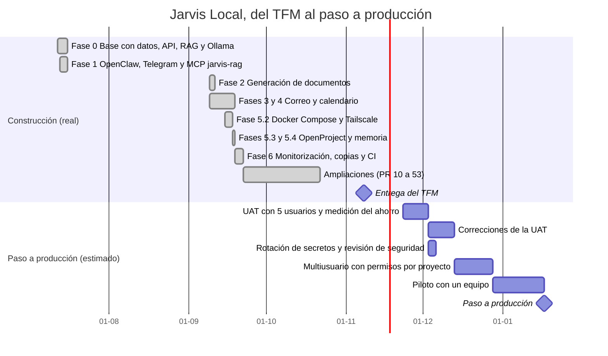

# Plan del proyecto

> **El plan vivo está en OpenProject.** Este documento es una foto versionada para leer
> junto al código. Las tareas, hitos, riesgos y dependencias del día a día se llevan en
> OpenProject, el mismo que Jarvis integra con el perfil `pm` de compose. Si este archivo y
> OpenProject no coinciden, manda OpenProject.

## Cómo se lleva el plan con la integración de OpenProject

Jarvis gestiona su propio plan con la skill MCP `jarvis-pm`
(`integrations/openclaw/skills/jarvis-pm`, lógica en `packages/openproject`), que habla con
la API v3 de OpenProject. Desde Telegram:

* `pm_setup` monta el proyecto con su metodología, su hito final y el equipo.
* `pm_create_task` crea tareas, hitos y riesgos (con probabilidad, impacto, mitigación y
  responsable), y `pm_link_tasks` registra dependencias que se ven en el Gantt de
  OpenProject.
* `pm_update_task` cambia estado, avance, fecha o responsable.
* `pm_status_report` da el informe de seguimiento: abiertos, vencidos, próximos 7 días,
  hitos y riesgos, con enlaces al Gantt.
* `pm_import_minutes` lleva a OpenProject las tareas y riesgos de un acta cuando el
  propietario lo confirma, y `pm_export_tasks` exporta el trabajo a Excel o Word.

Los riesgos de [raid.md](raid.md) se dan de alta en OpenProject como paquetes de tipo
*Riesgo*. Configuración y uso en [docs/OPENPROJECT.md](../OPENPROJECT.md).

## Cronograma

Hasta el 08-11-2026 las fechas salen del historial de git y de
[ROADMAP.md](../ROADMAP.md). Lo posterior es una estimación para el paso a producción y
depende de cerrar la UAT; se ajustará en OpenProject.

## Criterios para pasar de fase

| Paso | Se cierra cuando |
|---|---|
| UAT | 5 participantes (mínimo 3) completan el protocolo de [UAT.md](../UAT.md) y hay dato de tiempo con y sin Jarvis |
| Correcciones | Los fallos de la UAT están resueltos o aceptados como riesgo en [raid.md](raid.md) |
| Seguridad | Token de Telegram y contraseña del correo rotados; ningún secreto en logs (criterio 20) |
| Multiusuario | Solo si el piloto tiene más de un usuario (riesgo R9) |
| Piloto | El equipo usa Jarvis en su trabajo durante el periodo sin incidencias de severidad alta abiertas |

## English summary

Versioned snapshot of the project plan. The live plan is managed in OpenProject, which
Jarvis drives through its `jarvis-pm` MCP skill (tasks, milestones, risks, dependencies on
the Gantt and status reports from Telegram). Dates up to the thesis delivery on
08-11-2026 come from the git history; the production rollout dates are estimates that
depend on user acceptance testing.
